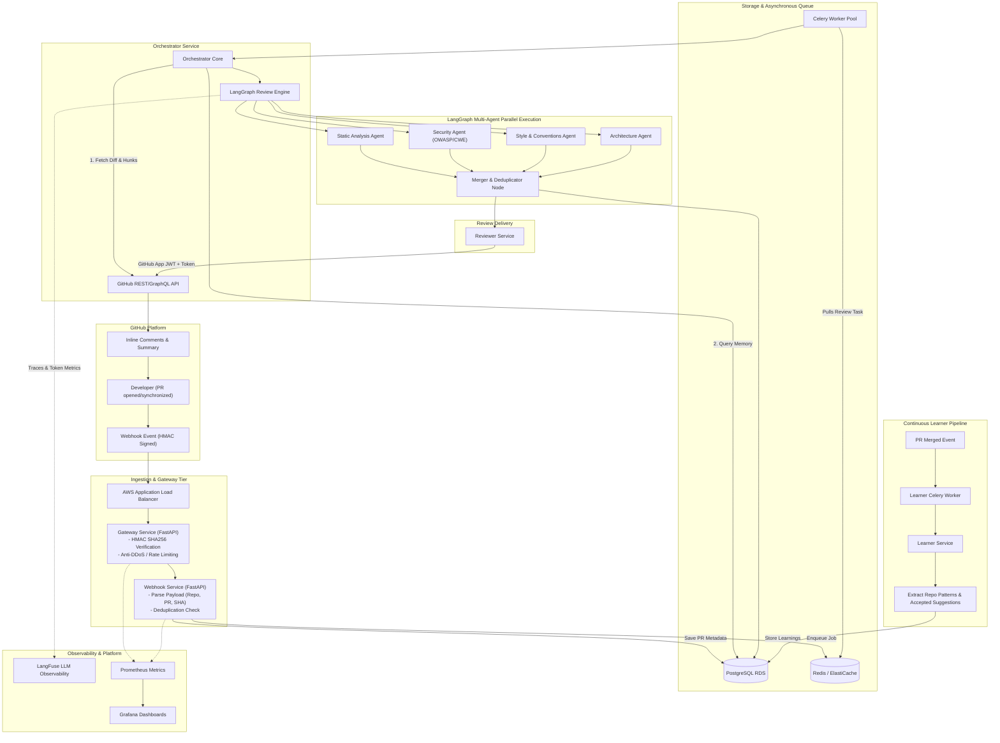
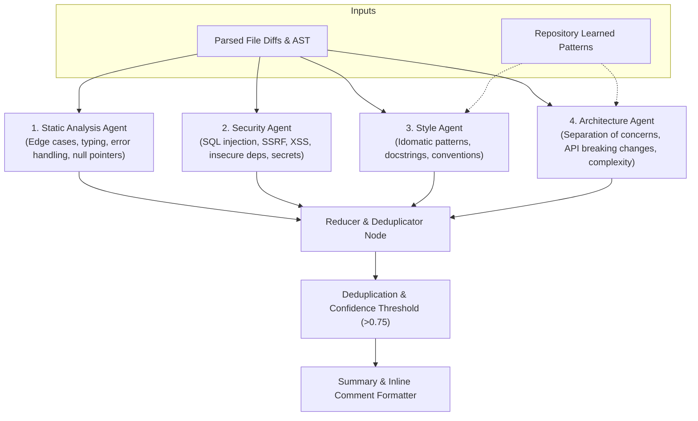
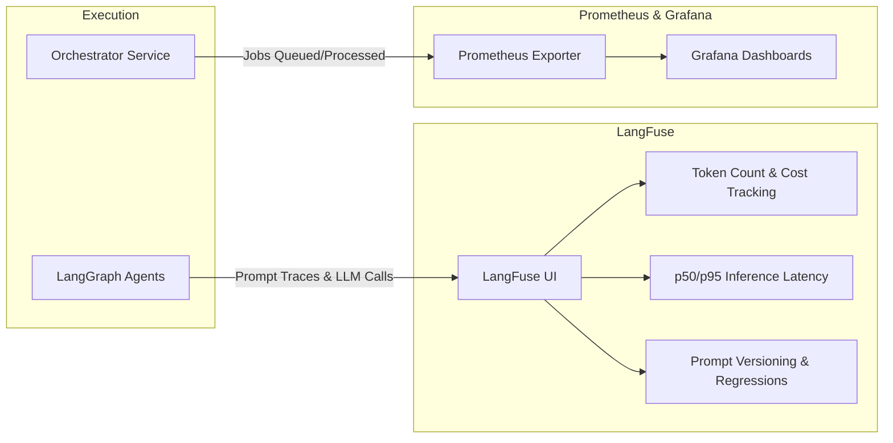
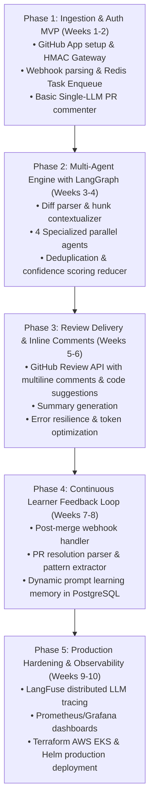

# AI-Powered Code Review Pipeline — Engineering Blueprint

This blueprint provides an end-to-end implementation architecture, technical specifications, database schemas, agent graph design, and deployment strategy for building the **AI-Powered Code Review Pipeline**.

---

## 1. System Architecture & High-Level Flow



---

## 2. Microservice Decomposition & Core Responsibilities

| Service | Runtime / Tech Stack | Primary Responsibilities |
| :--- | :--- | :--- |
| **Gateway Service** | Python 3.12, FastAPI, Uvicorn | • Ingress point behind AWS ALB.<br>• HMAC SHA-256 webhook signature verification (`X-Hub-Signature-256`).<br>• Replay attack prevention & payload pre-validation.<br>• Drops untrusted traffic before hitting internal queues. |
| **Webhook Service** | Python 3.12, FastAPI, SQLAlchemy | • Extracts PR event metadata (`action`, `pull_request.id`, `head.sha`, `base.sha`).<br>• Filters events (`opened`, `synchronize`, `reopened`).<br>• Performs idempotency check to avoid duplicate review runs on same commit SHA.<br>• Inserts PR record to PostgreSQL & dispatches event payload to Redis. |
| **Task Queue & Broker** | Redis 7+ / AWS ElastiCache, Celery | • Task queueing with dead-letter queue (DLQ) support.<br>• Exponential backoff retries for rate-limited GitHub API calls.<br>• Worker concurrency management based on agent execution load. |
| **Orchestrator Service** | Python 3.12, Celery Worker, PyGithub / Octokit | • Retrieves unified diffs and file trees from GitHub API.<br>• Chunks diffs into logical syntactic blocks/files with patch context.<br>• Loads repo-specific patterns and past reviewer feedback from PostgreSQL.<br>• Initializes and drives the LangGraph multi-agent execution pipeline. |
| **Multi-Agent Engine** | LangGraph, LangChain, LiteLLM / Anthropic / OpenAI | • Runs 4 specialized review agents in parallel on file diff chunks.<br>• Synthesizes findings, deduplicates conflicting suggestions, and resolves line numbers.<br>• Generates structured inline comments and high-level PR summaries. |
| **Reviewer Service** | Python 3.12, GitHub REST API | • Generates ephemeral GitHub App Installation Access Tokens using private key JWT.<br>• Posts batch inline comments via `/repos/{owner}/{repo}/pulls/{pull_number}/reviews`.<br>• Formats rich Markdown with code suggestions (`\`\`\`suggestion ... \`\`\``). |
| **Learner Service** | Python 3.12, Celery, Vector / Relational DB | • Triggers on PR `closed` with `merged: true`.<br>• Evaluates which AI comments were addressed vs dismissed.<br>• Distills coding standards and frequent repo conventions.<br>• Updates repo pattern memory for smarter future reviews. |
| **Observability** | Prometheus, Grafana, LangFuse | • LangFuse: Prompts, traces, model latencies, token consumption, and agent reasoning trees.<br>• Prometheus + Grafana: Webhook throughput, queue depth, p95/p99 review latency, error rates. |

---

## 3. Database Schema Design (PostgreSQL RDS)

```sql
-- Repositories registered with the GitHub App
CREATE TABLE repositories (
    id UUID PRIMARY KEY DEFAULT gen_random_uuid(),
    github_repo_id BIGINT UNIQUE NOT NULL,
    full_name VARCHAR(255) NOT NULL,
    installation_id BIGINT NOT NULL,
    default_branch VARCHAR(100) DEFAULT 'main',
    config JSONB DEFAULT '{}'::jsonb, -- e.g. enabled linters, rule overrides
    created_at TIMESTAMP WITH TIME ZONE DEFAULT NOW(),
    updated_at TIMESTAMP WITH TIME ZONE DEFAULT NOW()
);

-- Pull requests tracked
CREATE TABLE pull_requests (
    id UUID PRIMARY KEY DEFAULT gen_random_uuid(),
    repo_id UUID REFERENCES repositories(id) ON DELETE CASCADE,
    pr_number INT NOT NULL,
    title TEXT,
    author VARCHAR(255),
    head_sha VARCHAR(64) NOT NULL,
    base_sha VARCHAR(64) NOT NULL,
    status VARCHAR(50) DEFAULT 'pending', -- pending, reviewing, completed, failed
    created_at TIMESTAMP WITH TIME ZONE DEFAULT NOW(),
    updated_at TIMESTAMP WITH TIME ZONE DEFAULT NOW(),
    CONSTRAINT uq_repo_pr_sha UNIQUE (repo_id, pr_number, head_sha)
);

-- Review jobs executed by Celery / LangGraph
CREATE TABLE review_jobs (
    id UUID PRIMARY KEY DEFAULT gen_random_uuid(),
    pr_id UUID REFERENCES pull_requests(id) ON DELETE CASCADE,
    commit_sha VARCHAR(64) NOT NULL,
    status VARCHAR(50) NOT NULL, -- queued, processing, posted, failed
    summary_markdown TEXT,
    tokens_consumed INT DEFAULT 0,
    cost_usd NUMERIC(10, 6) DEFAULT 0.0,
    execution_time_ms INT,
    error_message TEXT,
    created_at TIMESTAMP WITH TIME ZONE DEFAULT NOW(),
    completed_at TIMESTAMP WITH TIME ZONE
);

-- Findings generated across all agents
CREATE TABLE agent_findings (
    id UUID PRIMARY KEY DEFAULT gen_random_uuid(),
    job_id UUID REFERENCES review_jobs(id) ON DELETE CASCADE,
    agent_name VARCHAR(100) NOT NULL, -- static_analysis, security, style, architecture
    file_path TEXT NOT NULL,
    line_start INT NOT NULL,
    line_end INT NOT NULL,
    severity VARCHAR(20) NOT NULL, -- info, low, medium, high, critical
    category VARCHAR(100),
    title VARCHAR(255) NOT NULL,
    comment_body TEXT NOT NULL,
    suggested_code TEXT,
    is_accepted_by_dedup BOOLEAN DEFAULT TRUE,
    github_comment_id BIGINT,
    created_at TIMESTAMP WITH TIME ZONE DEFAULT NOW()
);

-- Learner memory & learned repo patterns
CREATE TABLE repo_patterns (
    id UUID PRIMARY KEY DEFAULT gen_random_uuid(),
    repo_id UUID REFERENCES repositories(id) ON DELETE CASCADE,
    pattern_type VARCHAR(100) NOT NULL, -- naming_convention, security_rule, architectural_pattern
    rule_description TEXT NOT NULL,
    positive_example TEXT,
    negative_example TEXT,
    confidence_score NUMERIC(4, 3) DEFAULT 0.500,
    occurrences_count INT DEFAULT 1,
    last_validated_at TIMESTAMP WITH TIME ZONE DEFAULT NOW(),
    created_at TIMESTAMP WITH TIME ZONE DEFAULT NOW()
);
```

---

## 4. Multi-Agent Review Architecture (LangGraph)

### 4.1 State Definition

```python
from typing import Annotated, List, TypedDict, Optional
from pydantic import BaseModel, Field

class CodeFinding(BaseModel):
    agent: str
    file_path: str
    line_start: int
    line_end: int
    severity: str  # "info" | "warning" | "error" | "critical"
    title: str
    comment_body: str
    suggested_patch: Optional[str] = None
    confidence: float = Field(ge=0.0, le=1.0)

class ReviewState(TypedDict):
    pr_metadata: dict
    repo_rules: List[str]
    diff_hunks: List[dict]  # list of {file_path: str, hunk: str, patch: str}
    raw_findings: Annotated[List[CodeFinding], lambda a, b: a + b]
    deduped_findings: List[CodeFinding]
    pr_summary: str
```

### 4.2 Agent Specializations



1. **Static Analysis Agent**:
   - Focus: Off-by-one errors, unhandled promise rejections, unchecked nullable fields, resource leaks (unclosed sockets/files).
   - Prompt constraint: No subjective nitpicks; requires concrete failure scenario.

2. **Security Agent**:
   - Focus: Hardcoded credentials/tokens, tainted inputs in SQL/shell commands, CORS misconfigurations, path traversal vulnerabilities.
   - Reference standards: OWASP Top 10, CWE-20, CWE-89.

3. **Style & Conventions Agent**:
   - Focus: Project-specific idioms, docstrings on public APIs, clean coding standards.
   - Context injection: Uses `repo_patterns` retrieved from previous merges.

4. **Architecture Agent**:
   - Focus: Circular dependencies, boundary leaks across layers (e.g., DB models exposed in controller response), high cyclomatic complexity, breaking API contracts.

5. **Deduplicator & Reducer Node**:
   - Combines findings overlapping on the exact line ranges.
   - If Security and Static Analysis flag the same line, Security takes precedence.
   - Filters out comments with confidence `< 0.75` to keep noise minimal and developer trust high.

---

## 5. End-to-End Implementation Modules

### 5.1 Gateway Service: HMAC Verification (`gateway.py`)

```python
import hmac
import hashlib
from fastapi import FastAPI, Request, HTTPException, status
import httpx

app = FastAPI(title="PR Review Pipeline Gateway")
WEBHOOK_SECRET = "YOUR_GITHUB_WEBHOOK_SECRET_KEY".encode("utf-8")
WEBHOOK_SERVICE_URL = "http://webhook-service:8001/events"

@app.post("/webhook")
async def handle_github_webhook(request: Request):
    signature_header = request.headers.get("X-Hub-Signature-256")
    if not signature_header or not signature_header.startswith("sha256="):
        raise HTTPException(
            status_code=status.HTTP_401_UNAUTHORIZED,
            detail="Missing or invalid signature header"
        )

    expected_signature = signature_header.split("sha256=")[1]
    raw_body = await request.body()

    # Verify HMAC using constant-time comparison
    computed_signature = hmac.new(WEBHOOK_SECRET, raw_body, hashlib.sha256).hexdigest()
    if not hmac.compare_digest(computed_signature, expected_signature):
        raise HTTPException(
            status_code=status.HTTP_401_UNAUTHORIZED,
            detail="HMAC signature verification failed"
        )

    event_type = request.headers.get("X-GitHub-Event")
    delivery_id = request.headers.get("X-GitHub-Delivery")

    # Forward verified payload internally to Webhook Service
    async with httpx.AsyncClient() as client:
        resp = await client.post(
            WEBHOOK_SERVICE_URL,
            content=raw_body,
            headers={
                "Content-Type": "application/json",
                "X-GitHub-Event": event_type,
                "X-GitHub-Delivery": delivery_id
            },
            timeout=5.0
        )
    return {"status": "forwarded", "delivery_id": delivery_id}
```

### 5.2 Webhook Processing & Deduplication (`webhook_service.py`)

```python
from fastapi import FastAPI, Header, BackgroundTasks, HTTPException
from pydantic import BaseModel
import redis
import json

app = FastAPI()
redis_client = redis.Redis(host="redis-cluster", port=6379, db=0)

SUPPORTED_ACTIONS = {"opened", "synchronize", "reopened"}

@app.post("/events")
async def process_event(payload: dict, x_github_event: str = Header(None)):
    if x_github_event != "pull_request":
        return {"status": "ignored", "reason": f"Unhandled event type: {x_github_event}"}

    action = payload.get("action")
    if action not in SUPPORTED_ACTIONS:
        return {"status": "ignored", "reason": f"Action {action} ignored"}

    pr = payload["pull_request"]
    repo_full_name = payload["repository"]["full_name"]
    pr_number = pr["number"]
    head_sha = pr["head"]["sha"]

    # Deduplication key in Redis (expires after 1 hour)
    dedup_key = f"review_lock:{repo_full_name}:{pr_number}:{head_sha}"
    is_new = redis_client.set(dedup_key, "queued", nx=True, ex=3600)
    
    if not is_new:
        return {"status": "skipped", "reason": "Job for commit SHA already in progress"}

    # Enqueue task for Celery orchestrator
    task_payload = {
        "repo_name": repo_full_name,
        "installation_id": payload["installation"]["id"],
        "pr_number": pr_number,
        "head_sha": head_sha,
        "base_sha": pr["base"]["sha"]
    }
    redis_client.rpush("celery_queue:review_tasks", json.dumps(task_payload))

    return {"status": "enqueued", "pr": pr_number, "head_sha": head_sha}
```

### 5.3 Reviewer Service: GitHub API Integration (`reviewer.py`)

```python
import jwt
import time
import httpx

class GitHubReviewPoster:
    def __init__(self, app_id: str, private_key_pem: str):
        self.app_id = app_id
        self.private_key = private_key_pem

    def _get_app_jwt(self) -> str:
        now = int(time.time())
        payload = {
            "iat": now - 60,
            "exp": now + (10 * 60),
            "iss": self.app_id
        }
        return jwt.encode(payload, self.private_key, algorithm="RS256")

    async def get_installation_token(self, installation_id: int) -> str:
        app_jwt = self._get_app_jwt()
        url = f"https://api.github.com/app/installations/{installation_id}/access_tokens"
        headers = {
            "Authorization": f"Bearer {app_jwt}",
            "Accept": "application/vnd.github+json"
        }
        async with httpx.AsyncClient() as client:
            res = await client.post(url, headers=headers)
            res.raise_for_status()
            return res.json()["token"]

    async def post_pr_review(
        self,
        installation_id: int,
        owner: str,
        repo: str,
        pr_number: int,
        commit_sha: str,
        summary_body: str,
        comments: list[dict]
    ):
        """
        Submits comments in batch using the GitHub Pull Request Review API.
        comments schema:
        [{"path": "src/app.py", "line": 42, "side": "RIGHT", "body": "..."}]
        """
        token = await self.get_installation_token(installation_id)
        url = f"https://api.github.com/repos/{owner}/{repo}/pulls/{pr_number}/reviews"
        headers = {
            "Authorization": f"token {token}",
            "Accept": "application/vnd.github+json"
        }
        payload = {
            "commit_id": commit_sha,
            "body": summary_body,
            "event": "COMMENT",  # or "REQUEST_CHANGES" / "APPROVE"
            "comments": comments
        }
        async with httpx.AsyncClient() as client:
            res = await client.post(url, json=payload, headers=headers)
            res.raise_for_status()
            return res.json()
```

---

## 6. The Continuous Learner Pipeline

When a developer merges a pull request:
1. GitHub fires `pull_request` event with `action: closed` and `merged: true`.
2. The **Learner Worker** pulls:
   - All AI suggestions originally submitted by the Reviewer Service.
   - The final diff that was merged into `main`.
   - Any follow-up comments or developer replies on review threads.
3. **Pattern Classification & Synthesis**:
   - If developer committed the suggested patch: Mark rule as **Validated (+Confidence)**.
   - If developer dismissed or marked "won't fix": Reduce weight of the rule or flag agent false positive.
   - Extract recurring repo-specific conventions (e.g., custom error wrapper `AppError` required across all endpoints, strict logging format).
4. Store updated patterns into `repo_patterns` table in PostgreSQL RDS.
5. In future runs, the Orchestrator passes these dynamic rules directly into the prompts of the **Style** and **Architecture** agents.

---

## 7. Monitoring, Observability & Tracing



### Metrics Tracked
- **System Metrics**: Webhook delivery latency, Celery task wait time, Redis memory consumption, EKS CPU/memory utilization.
- **LLM Performance Metrics** (via LangFuse):
  - Agent token overhead per review.
  - Per-agent execution latency.
  - Model fallback rate (if rate-limited on primary LLM provider).
- **Quality & Business Metrics**:
  - Review generation time ($p90 < 60\text{ seconds}$).
  - Developer acceptance rate of AI suggestions ($> 65\%$).
  - Comment dismissal rate ($< 15\%$).

---

## 8. Deployment, Infrastructure & CI/CD (AWS EKS)

### 8.1 Infrastructure Blueprint (Terraform / AWS)
- **Networking**: VPC across 3 Availability Zones, Public Subnets (ALB & NAT Gateways), Private Subnets (EKS Worker Nodes, Redis, RDS).
- **Compute**: AWS EKS cluster with managed node groups (using EC2 Spot instances for Celery LLM workers to optimize compute costs).
- **Data Stores**:
  - AWS ElastiCache for Redis (Cluster mode enabled).
  - AWS RDS PostgreSQL (Multi-AZ for high availability).
- **Secrets Management**: AWS Secrets Manager (storing GitHub App Private Keys, Webhook Secrets, and LLM API Keys).

### 8.2 Kubernetes Architecture
- `ingress-controller`: AWS Load Balancer Controller managing public Ingress for the Gateway.
- `gateway-deployment`: Autoscaling pods (HPA based on HTTP request rate).
- `webhook-deployment`: Lightweight ingestion pods.
- `celery-worker-orchestrator`: HPA scaling on Redis queue depth (`celery_queue:review_tasks`).
- `celery-worker-learner`: Dedicated worker pool for post-merge processing.

### 8.3 CI/CD Pipeline (GitHub Actions)
```yaml
name: Deploy Pipeline Services to EKS

on:
  push:
    branches: [main]

jobs:
  build-and-deploy:
    runs-on: ubuntu-latest
    steps:
      - uses: actions/checkout@v4

      - name: Configure AWS Credentials
        uses: aws-actions/configure-aws-credentials@v4
        with:
          aws-access-key-id: ${{ secrets.AWS_ACCESS_KEY_ID }}
          aws-secret-access-key: ${{ secrets.AWS_SECRET_ACCESS_KEY }}
          aws-region: us-east-1

      - name: Log in to AWS ECR
        id: login-ecr
        uses: aws-actions/amazon-ecr-login@v2

      - name: Build, tag, and push Docker images
        env:
          REGISTRY: ${{ steps.login-ecr.outputs.registry }}
        run: |
          docker build -t $REGISTRY/pr-review-gateway:latest -f docker/gateway.Dockerfile .
          docker build -t $REGISTRY/pr-review-orchestrator:latest -f docker/orchestrator.Dockerfile .
          docker push $REGISTRY/pr-review-gateway:latest
          docker push $REGISTRY/pr-review-orchestrator:latest

      - name: Deploy to EKS via Helm
        run: |
          aws eks update-kubeconfig --name code-review-eks-cluster --region us-east-1
          helm upgrade --install pr-review-system ./deploy/helm/pr-review \
            --set image.tag=latest \
            --values ./deploy/helm/values-production.yaml
```

---

## 9. Phased Implementation Roadmap


